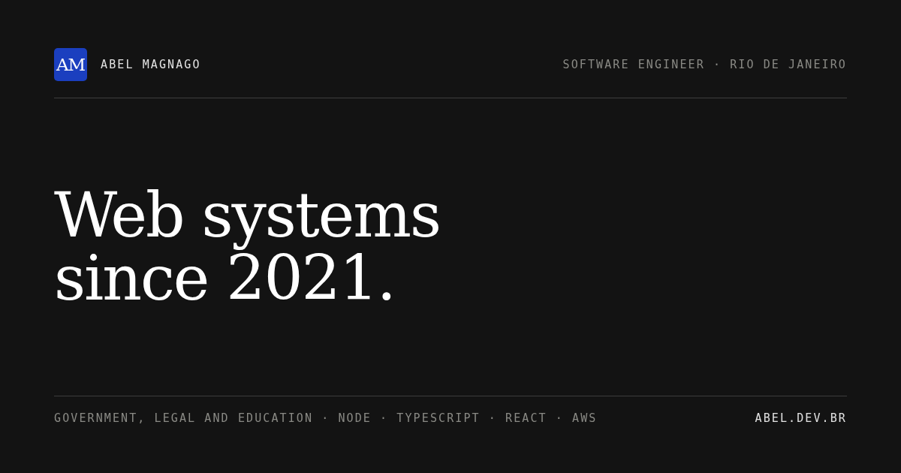
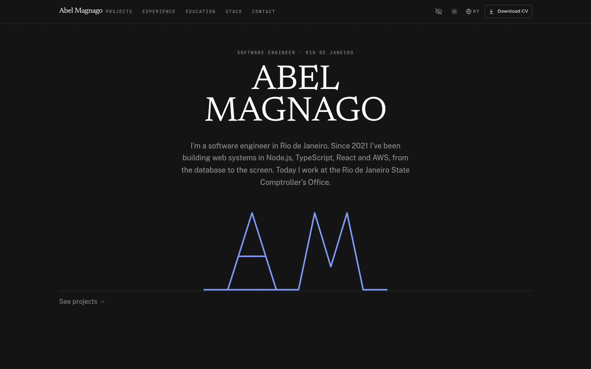
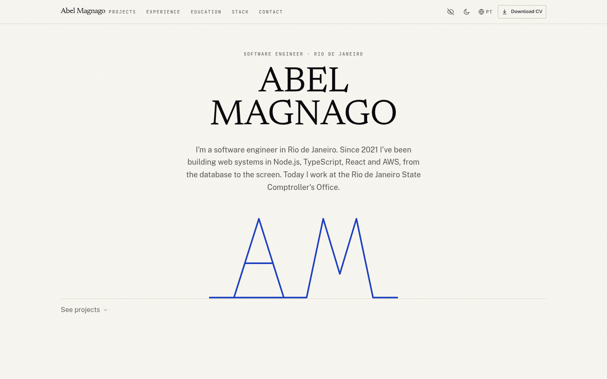
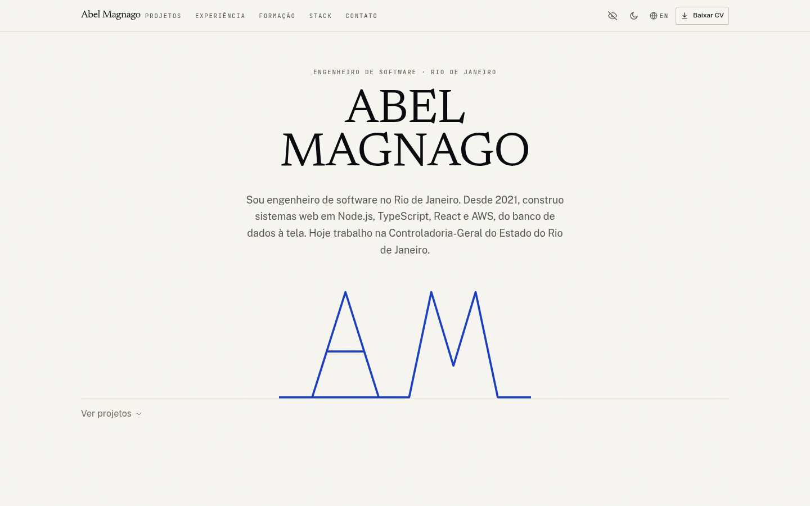
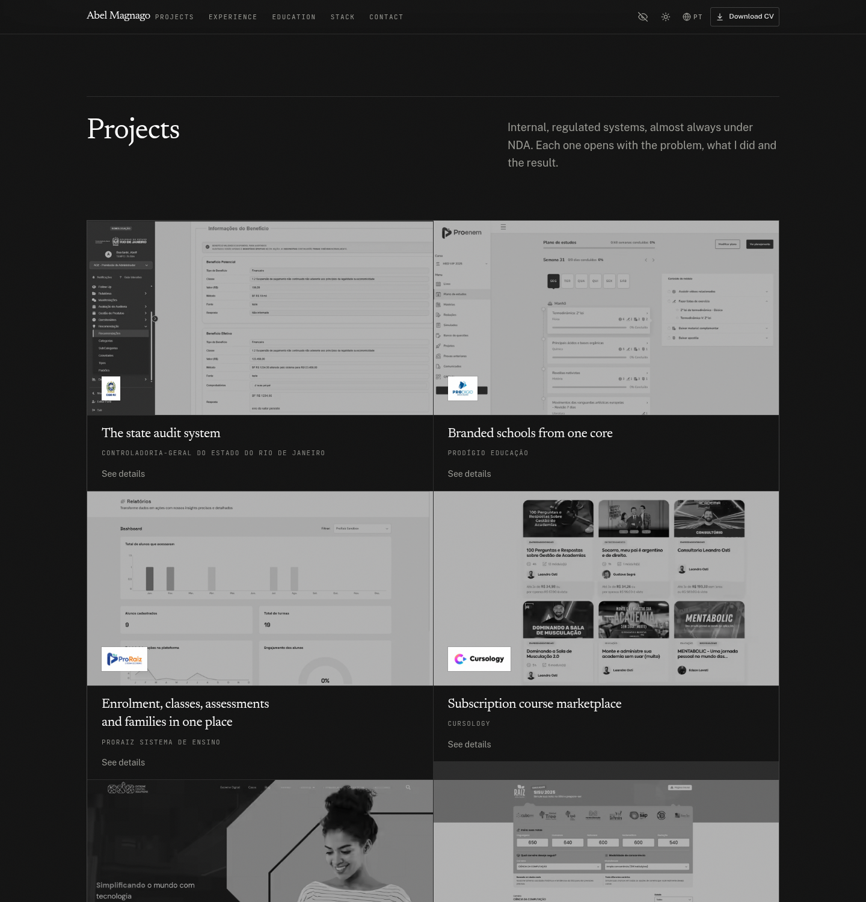
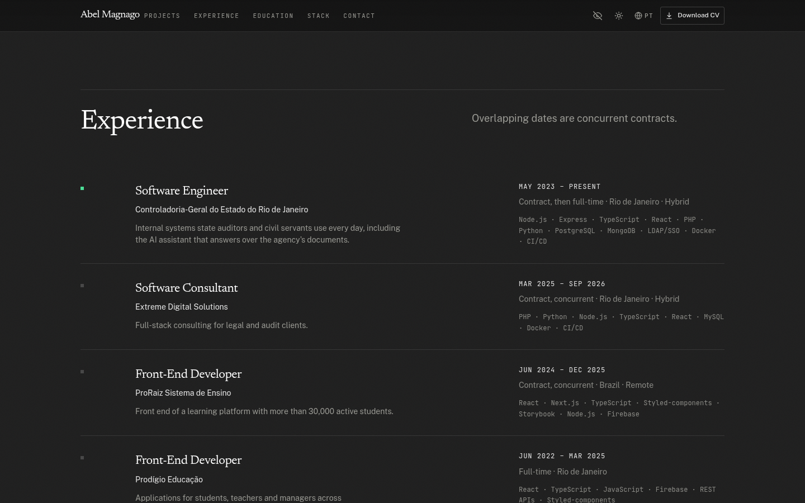
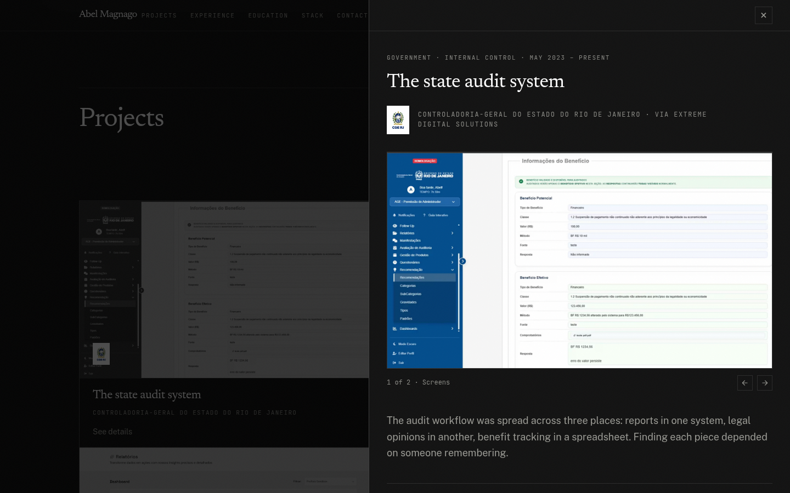
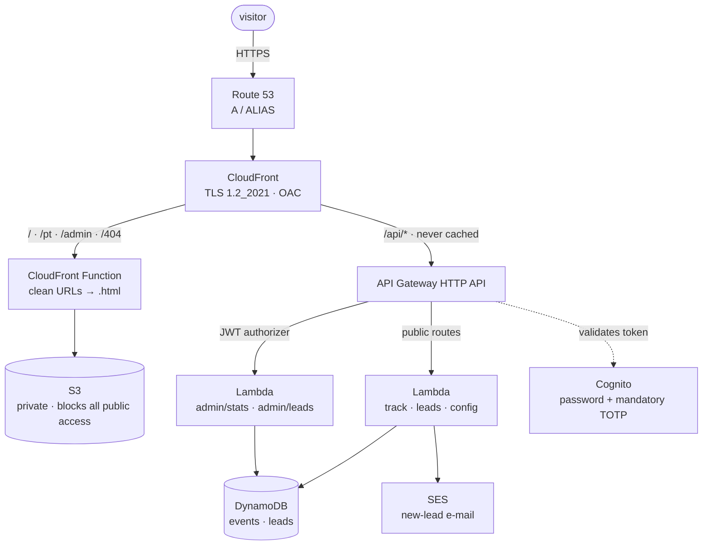

# Abel Magnago · portfolio

**A static Next.js site on AWS, provisioned end to end with Serverless Framework.**
The public page is one half of it; the other half is a small first-party backend
(analytics, contact, an admin panel behind Cognito + TOTP) wired into the same
domain through CloudFront.

<p>
  <a href="https://abel.dev.br"></a>
  <a href="https://www.linkedin.com/in/abel-magnago1"></a>
  <a href="https://github.com/abelmagnag0"></a>
  
  
  
  
</p>

<!-- TOC -->
## Contents

- [Screenshots](#screenshots)
- [What this is](#what-this-is)
- [The idea behind it](#the-idea-behind-it)
- [Art direction](#art-direction)
- [Architecture](#architecture)
- [Infrastructure, service by service](#infrastructure-service-by-service)
- [The application layers](#the-application-layers)
- [Serverless, and why](#serverless-and-why)
- [Security posture](#security-posture)
- [SEO and performance](#seo-and-performance)
- [Run it locally](#run-it-locally)
- [First-time setup](#first-time-setup)
- [Deploying](#deploying)
- [Repo map](#repo-map)
- [Links](#links)

---

## Screenshots

Captured from the built site, not mocked up. The framing changes but the content
doesn't: the artefacts below are the page as it ships.

### The title page, both themes

Dark is the default. Light is warm paper, and it's applied before first paint
so there's no flash when you switch.

| Dark (default) | Light |
| --- | --- |
|  |  |

### Portuguese, at `/pt`

| |
| --- |
|  |

### The document below the cover

Third person, left aligned, separated by 1px rules and space. On the left, the
project cards; on the right, one case opened, with the problem, the screens and
the result.

| Projects | Experience |
| --- | --- |
|  |  |

| A case, opened |
| --- |
|  |

## What this is

A portfolio site for a software engineer, and a deliberate excuse to build the
whole thing properly: hand-written design system, static export, real
infrastructure as code, first-party analytics with no third-party tracker, and
an admin panel that only I can open.

It is also, unavoidably, **a portfolio of the portfolio**. Every decision that
would normally be invisible (why this accent colour, why the S3 bucket is
private, why there is no Inter font) is written down in the code as a comment
next to the decision it explains. This README is the map to those decisions.

Two rules shaped the whole thing:

1. **Nothing on the page may be a claim I can't back up in an interview.**
   The copy describes the object that was built, with the number attached,
   instead of listing the phases of a job title.
2. **No design decision may be the framework default.** The default is exactly
   what makes a page read as machine-made, so each one was either justified in
   writing or replaced.

## The idea behind it

The site is laid out as a **document**, not a landing page:

- The first screen is a **title page** (*folha de rosto*): the role, the name in
  a large serif, one sentence, and the author's signature drawn at the foot.
  That is the one place on the site written in the first person and centred.
- Everything below it is **document**: third person, left-aligned, separated by
  1px rules and space rather than cards and shadows.
- Nothing advertises availability. The role is stated as identity, not as a
  signal that I'm on the market.
- Each section carries a **decision note**: a small floating annotation (built
  with `driver.js`) that says what was chosen and why. It can be turned off, and
  it stays off.
- One section points at **this repository**: the page, the API, the
  infrastructure and the admin panel live in the same public repo, so a claim
  made on the site can be read in the code behind it. The site is its own
  example.

## Art direction

The palette was **derived from my own portrait** (the warm khaki-to-cream range
in the photograph) rather than picked from a preset. That single constraint is
what keeps the page from looking like a theme.

| | |
| --- | --- |
| **Surface** | Three steps only: `#131313` paper, `#1f1f1f` alternating band, `#2a2a2a` elevated. Separation comes from the step and a 1px rule, **never** from a shadow. |
| **Ink** | A four-step ramp, each value **measured with the WCAG 2.x contrast formula** against the real background of each element. The table with every ratio is in `src/app/globals.css`. |
| **Accent** | Cobalt `#1b3fbf`. High contrast on paper, and deliberately far from generic SaaS blue and from the purple gradient that gives away a generated interface. It is the **only** colour on a page otherwise made of black, white and a 1px rule. |
| **Type** | Three families, three jobs: **Newsreader** (editorial high-contrast serif, display only), **Public Sans** (body and UI), **JetBrains Mono** (numbers, section labels, dates, stack). Not Inter, not Roboto, not `system-ui`. That is the first symptom of a machine-generated page. |
| **Shape** | Radius `0` on structural surfaces, `3px` on interactive elements. No large radius, no pills, no floating cards. |
| **Texture** | A paper grain, as an inline SVG `feTurbulence`, with no `mix-blend-mode` on purpose, to keep the compositing cost predictable while scrolling. |
| **Theme** | Dark is the default. Light (warm paper) is the alternate, chosen by the visitor or by the OS, applied before first paint by a small inline script so there is no flash. |

The signature at the foot of the title page is **drawn, not illustrated**: a
single `<path>` of thirteen points, under 300 bytes, inside the HTML that was
already being sent. One line, one weight, no fill, no gradient, no mask, no
bitmap, no imported vector. It costs nothing after the text and it can't break
without a network. The grid it was built on (a 7:3 viewBox, apex and baseline,
the width ratio of each letter) is documented next to it in
`src/library/sections/cover.tsx`.

One motif was cut on the way here, and the reason is recorded beside the code:
the piece that preceded the monogram was a celestial body with three layers of
surface, and it left for exactly that reason, because a large arc rising from
the footer is already somebody else's visual signature.

## Architecture



The static export and the API share one domain, so nothing needs CORS from the
browser's point of view: `/api/*` is a CloudFront cache behaviour pointing at the
HTTP API origin.

## Infrastructure, service by service

All of it is CloudFormation written as Serverless Framework resources, split by
concern under `sls/`. What each service is actually doing here:

| Service | Role | Notable choices |
| --- | --- | --- |
| **S3** | Origin for the static export. | Private: `PublicAccessBlockConfiguration` sets all four flags, `OwnershipControls` enforces bucket-owner. The bucket policy grants read **only** to the CloudFront service principal, additionally restricted with a `AWS:SourceArn` condition to this exact distribution. `DeletionPolicy: Retain`. |
| **CloudFront** | One entry point for the site and the API, TLS, caching. | Origin Access Control (SigV4, sign always) instead of a public bucket. Static assets use the managed *CachingOptimized* policy and are compressed; `/api/*` uses *CachingDisabled*. 403 and 404 both render `/404.html`. Certificate is SNI-only at TLS 1.2_2021. |
| **CloudFront Function** | Clean URLs. | The static export emits `pt.html`, not `pt/index.html`, so a viewer-request function (JavaScript, `cloudfront-js-2.0`) normalises the trailing slash and appends `.html` to extensionless paths. That's what makes `/pt` and `/admin` work without a file extension. |
| **Route 53** | DNS. | Two `A` ALIAS records (apex and `www`) pointing at the distribution. |
| **ACM** | Certificate. | DNS-validated for apex + `www`, in `us-east-1` (the region CloudFront requires, regardless of where the stack lives). |
| **API Gateway** | HTTP API in front of the Lambdas. | CORS allow-list is explicit. A **JWT authorizer** validates Cognito access tokens at the gateway, so the two admin Lambdas are never even invoked without a valid token. |
| **Lambda** | Five handlers, one job each. | `track`, `leads`, `admin-config` are public; `admin-stats`, `admin-leads` sit behind the authorizer. IAM is least-privilege: `PutItem`/`Query`/`UpdateItem` on the two tables and their indexes, plus `ses:SendEmail`. Only `dist-api/**` is packaged, which keeps the zip tiny. |
| **DynamoDB** | Two tables, pay-per-request. | `events` (analytics) has a `byDay` GSI and a **TTL of 400 days**. `leads` has a `byStatus` GSI. Both are `Retain` on delete. |
| **SES** | New-lead notification. | Runs in `sa-east-1` (identities verified, out of the sandbox) while the stack is in `us-east-1`, so the region is pinned through a `SES_REGION` env var. The sender is `no-reply@abel.dev.br`. |
| **Cognito** | Admin identity. | A single user pool with **no self-signup** (`AllowAdminCreateUserOnly`), a 12-character minimum password policy, and **mandatory TOTP**. The app client is **public, with no client secret** (`Authorization Code + PKCE`), because a static site runs its auth code in the browser and a public client is the correct fit for that. |

## The application layers

Beyond the static page, the same domain serves a small backend at `/api/*`,
proxied by CloudFront.

| Method | Route | What it does |
| --- | --- | --- |
| `POST` | `/api/track` | Records one analytics event |
| `POST` | `/api/leads` | Receives the contact form, stores the lead, notifies me |
| `GET` | `/api/config` | Publishes the public Cognito host + client id the admin panel needs |
| `GET` | `/api/admin/stats?days=30` | Aggregated metrics (JWT required) |
| `GET` | `/api/admin/leads` | Recent leads (JWT required) |
| `PATCH` | `/api/admin/leads` | Updates a lead status (`new`/`read`/`replied`, JWT required) |

- **Analytics, first-party.** The client (`src/library/analytics/`) posts
  `pageview`, `cv_download`, `contact_submit`, `contact_success`,
  `contact_error`, `social_click`, `project_view`, `section_view`,
  `language_switch` and `outbound_click` to `/api/track`. There is no
  third-party tracker. Geolocation comes from CloudFront's
  `CloudFront-Viewer-*` headers, so **the visitor's IP is never read**.
- **Contact.** `src/library/sections/contact.tsx` posts to `/api/leads`. The
  handler has a honeypot field, length caps on every field, an HTML-escaped
  e-mail body, and it normalises `\r\n` before using the address as the SES
  reply-to, so a header can't be injected.
- **Admin.** `/admin` is a static client-side page that signs in through Cognito
  (Authorization Code + PKCE) and calls the API with the access token. TOTP is
  required, and the page is `noindex` and disallowed in `robots.txt`. The
  session lasts 30 days per browser: the refresh token lives in `localStorage`,
  rotates on every renewal, and is revoked on sign-out.

Handler sources live in `backend/` and are bundled by `scripts/build-api.mjs`
(esbuild) into `dist-api/`, which is the only thing Serverless packages.

## Serverless, and why

The whole stack is one `sls deploy` away from existing, and deploying content is
one command that doesn't touch infrastructure. That split is the point:

- **`pnpm run deploy`** does infrastructure. `build:api` then `sls deploy`.
  CloudFormation creates or updates every resource above, including the
  `/api/*` behaviour on the CloudFront distribution.
- **`pnpm run publish`** does content. `pnpm build` (static export to `out/`),
  then `aws s3 sync ./out` and a CloudFront invalidation. No infrastructure
  change.

Two traps are worth knowing before you run either:

- **`pnpm deploy` and `pnpm publish` without `run` are pnpm's own commands**
  (workspace deploy, registry publish) and won't touch this project's scripts.
  Use `pnpm run`.
- **The service is named `portfolio`, but the stack is still
  `portfolio-site-dev`.** The stack was created when the project lived on a
  different computer, and it already owns the CloudFront distribution and the
  DNS records. Renaming it would create a parallel stack and the `A`/`ALIAS`
  records would collide. To migrate properly you'd remove `ApexRecord` and
  `WwwRecord` first. This is pinned deliberately in `serverless.yml`.

Serverless Framework v4 also refuses to run without a login or a key; the
first-time setup below covers that.

## Security posture

- **No application secret exists.** There is no password, no session secret and
  no HMAC key in the repo, in the CloudFormation template, or in any Lambda's
  environment. Identity lives in Cognito and the gateway validates the token.
  This was a deliberate move away from an earlier SSM-password design, where the
  secret would have been resolvable into the template and into
  `aws lambda get-function-configuration`.
- The S3 bucket blocks all public access and is readable only by this
  distribution, enforced by `SourceArn`.
- CloudFront redirects viewers to HTTPS and serves TLS 1.2_2021 minimum. HSTS
  (one year, apex and `www`, no subdomains), `X-Content-Type-Options: nosniff`,
  `X-Frame-Options: DENY` and a strict-origin referrer policy go on every
  response, site and API.
- Admin: password (12+ chars) **and** mandatory TOTP. The pool allows no
  self-signup. The gateway's JWT authorizer runs before any admin Lambda.
  Sessions last 30 days per browser, with refresh-token rotation and a 60 s
  reuse grace; signing out revokes the refresh token server-side.
- Analytics stores no IP address; events self-delete after 400 days.
- The contact endpoint has a honeypot and normalises input against header
  injection. Public routes are throttled at the gateway before the Lambda runs:
  5 req/s (burst 10) for the contact form, 20 req/s for analytics, and a 50 req/s
  ceiling for the API as a whole.

## SEO and performance

Built to be crawled, ranked and read.

- **Content that is crawlable without JavaScript.** Each project card carries a
  visually-hidden (`sr-only`, i.e. `clip-path`, not `display:none`) copy of the
  full case text, so a crawler that doesn't execute scripts still sees what was
  built. The visible card is unchanged.
- **Structured data**, via `next-seo`: a `ProfilePageJsonLd` for the author, a
  `WebSite` + `Person` graph, `WorkJsonLd` (an `ItemList` of `CreativeWork`s with
  the stack as keywords), and `NavigationJsonLd` (`SiteNavigationElement`). The
  `Person` nodes share one `@id` so the search engine treats them as one entity.
- **Internationalisation**: English at `/`, Portuguese at `/pt`, with canonical
  and `hreflang` (including `x-default`) generated from a single source of truth.
- **OG/Twitter cards** are static 1200×630 PNGs (`public/og.png`, `og-en.png`)
  built by `scripts/build-og.mjs`. Next's `opengraph-image.tsx` convention is
  **not** used: it requires an edge runtime, and with `output: 'export'` the file
  was simply never generated, so every link preview 404'd.
- **Performance**: CSS is inlined into the exported HTML (`scripts/inline-css.mjs`)
  so the first paint needs no CSS request; the case dossier is a lazy
  `import()`; off-screen sections use `content-visibility: auto`; the cover
  signature is code, not an image; `sitemap.ts` and `robots.ts` come from the
  Metadata API.

Validate the result with the Rich Results Test, the LinkedIn Post Inspector and
Twitter's Card Validator.

## Run it locally

Requirements: Node 18.18+, `pnpm`, and the AWS CLI configured (only for
publishing).

```bash
pnpm install
pnpm dev          # dev server
pnpm build        # static export → out/
pnpm typecheck    # tsc --noEmit
pnpm lint         # eslint
```

### Docker dev server

Runs the dev server (with hot reload) in a container, with the project mounted:

```bash
pnpm install            # once, on the host (the container reuses node_modules)
docker compose up       # → http://localhost:4321
```

Or without compose:

```bash
docker run --rm -it --user "$(id -u):$(id -g)" -e HOME=/tmp \
  -v "$PWD":/app -v "$PWD/.next-container":/app/.next -w /app -p 4321:3000 node:22-slim \
  ./node_modules/.bin/next dev -H 0.0.0.0 -p 3000
```

`.next` is isolated in `.next-container/` (gitignored) so a `pnpm build` on the
host can't corrupt a dev server that's running. There's also a `Dockerfile`
with a self-contained build for when you don't want to depend on the host's
`node_modules`.

> Locally, `/api/*` doesn't exist, so analytics fail silently and admin login
> won't connect. For a full preview, point `NEXT_PUBLIC_API_BASE` at a local API
> or deploy. The Cognito pool accepts callbacks on `localhost:3000`, `:3100` and
> `:4321`; another port must be added to `CallbackURLs`/`LogoutURLs` in
> `sls/cognito.yml`.

## First-time setup

0. Authenticate the Serverless Framework. v4 refuses any command without a login
   or a licence key:

   ```bash
   sls login
   ```

   A machine can keep a stale key (`~/.serverlessrc` with `userId: null`) even
   after you switch computers. To run without a terminal, set
   `SERVERLESS_ACCESS_KEY` or `SERVERLESS_LICENSE_KEY`.

1. Verify the SES sender (`no-reply@abel.dev.br`). The domain is verified, or in
   sandbox the recipient. Adjust `custom.leadRecipient` / `custom.sesSender` in
   `serverless.yml` if needed.

2. Deploy the infrastructure (API, tables, Cognito, and the `/api/*` behaviour on
   CloudFront):

   ```bash
   pnpm run deploy
   ```

3. Create the single admin user. The script prompts for the e-mail and password
   in the terminal and never writes the password to a file:

   ```bash
   pnpm run admin:create
   ```

4. Open `https://abel.dev.br/admin` and sign in. Cognito asks for e-mail and
   password, and on the first login shows the QR code to register the
   authenticator app. Subsequent logins ask for the 6-digit code.

   Lost the phone or switched authenticator?

   ```bash
   pnpm run admin:reset-mfa
   ```

   That removes the TOTP; the next login registers a new one. There is no
   self-service way to remove the second factor, on purpose.

## Deploying

```bash
pnpm run build:api   # esbuild → dist-api/
sls deploy           # or: pnpm run deploy
```

To publish content after a change (build, S3 sync, CloudFront invalidation):

```bash
pnpm run publish
```

Optional env vars for the publish script: `STACK_NAME` (default
`portfolio-site-dev`), `AWS_PROFILE`, `AWS_REGION` / `AWS_DEFAULT_REGION`, and
`DOMAIN_NAME` (used as a fallback to find the distribution by alias).

Regenerating assets:

```bash
pnpm images   # portrait crops (4:5 and square) from assets/portrait-source.png
pnpm logos    # project logos → public/projects/*
pnpm og       # link cards → public/og.png and public/og-en.png
pnpm assets   # all three (images + logos + og)
```

`pnpm og` reuses the `.woff2` files emitted by `next/font` into `.next/` and
needs `chromium` on `PATH`, so run it after a `pnpm build`. `pnpm images` shells
out to `ffmpeg`, which also needs to be on `PATH`.

## Repo map

```
backend/          Lambda handler sources (bundled to dist-api/ by esbuild)
docs/             screenshots used by this README (real captures of the built site)
sls/              CloudFormation resources, split by service
  cognito.yml       user pool, TOTP, public PKCE client
  s3.yml            private bucket + CloudFront-only bucket policy
  cloudfront.yml    distribution, OAC, clean-URL function, /api/* behaviour
  dynamodb.yml      events (byDay, 400-day TTL) and leads (byStatus)
  route53.yml       apex + www ALIAS records
  acm.yml           DNS-validated certificate
scripts/          build-api · inline-css · build-og · prepare-images/logos · publish.sh · admin scripts
src/
  app/(en)/         root route group "/" (English metadata)
  app/(pt)/         "/pt" (Portuguese metadata)
  app/globals.css   design tokens, with the contrast table
  library/sections/ the page, section by section (+ *.data.ts as the content source)
  library/seo/      site constants and the JSON-LD builders
serverless.yml    provider, functions, IAM, and the pinned stack/bucket name
```

## Links

- **Live site**: [abel.dev.br](https://abel.dev.br) · [português](https://abel.dev.br/pt)
- **LinkedIn**: [abel-magnago1](https://www.linkedin.com/in/abel-magnago1)
- **GitHub**: [abelmagnag0](https://github.com/abelmagnag0)